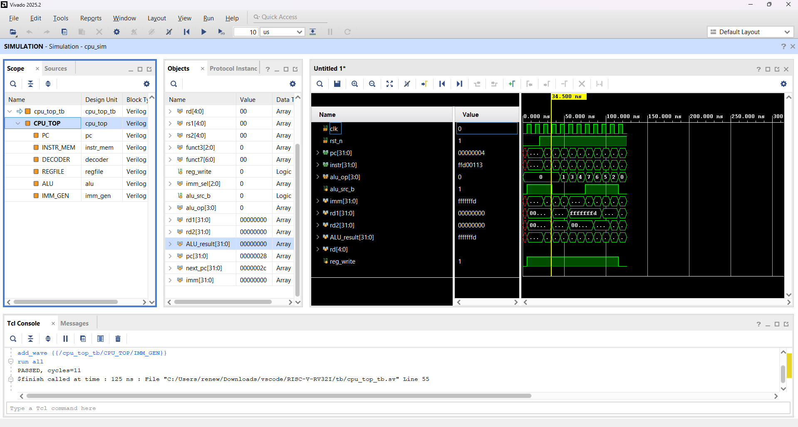
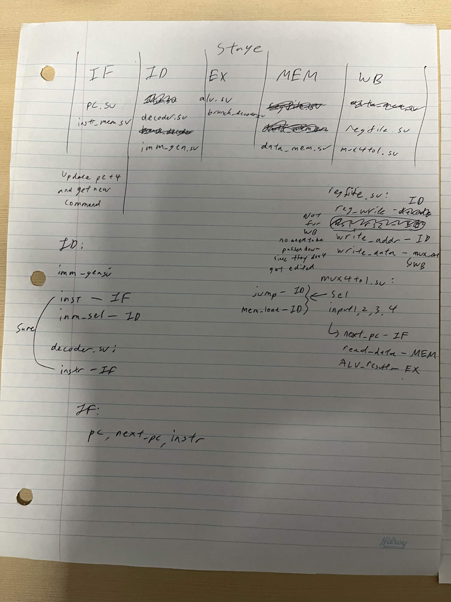
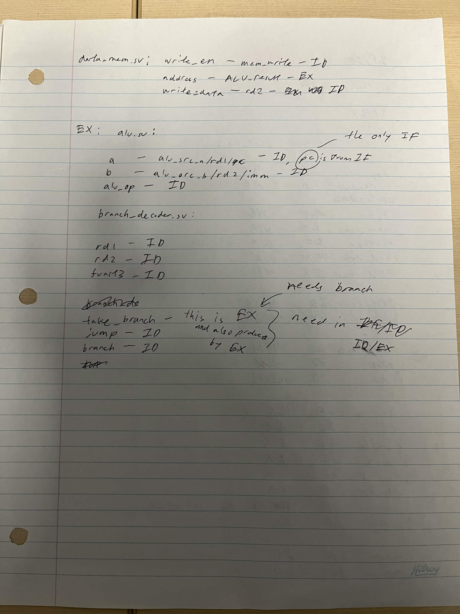
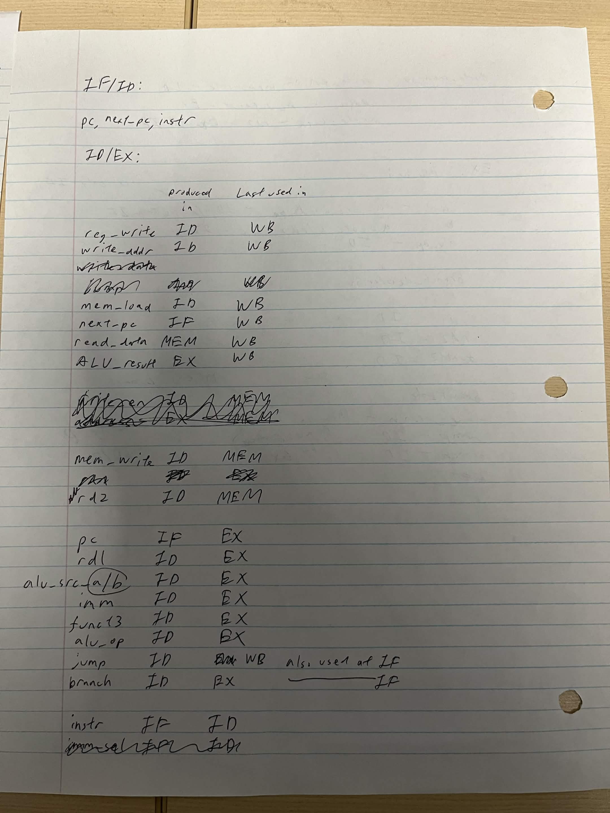

# RISC-V RV32I

A 5-stage pipelined RV32I core in SystemVerilog, simulated with Vivado XSim 2025.2.

## Status
- [x] Single-cycle core (`single_cycle_rtl/`), used as the reference
- [x] 5-stage pipeline: IF / ID / EX / MEM / WB (`pipeline_rtl/`)
- [x] Data forwarding: EX/MEM -> EX, MEM/WB -> EX, WB -> ID (regfile bypass)
- [x] Load-use hazard detection + 1-cycle stall
- [x] Static predict not-taken, flush IF/ID and ID/EX on taken branch / jump
- [ ] Dynamic branch prediction (BHT + BTB)

## Scope
Unprivileged RV32I, minus:
- CSRs, traps, interrupts
- FENCE, ECALL, EBREAK
- Sub-word loads/stores (LB, LH, LBU, LHU, SB, SH). Only LW/SW.

Supported: all R-type, I-type ALU, LW, SW, all 6 branches, JAL, JALR, LUI, AUIPC.

references:
- [RISC-V Unprivileged ISA spec](https://docs.riscv.org/reference/isa/v20260120/unpriv/unpriv-index.html)
- [RV32I instruction reference](https://www.cs.unh.edu/~pjh/courses/cs520/15spr/riscv-rv32i-instructions.pdf)

## Testing
32 tests from the official [riscv-tests](https://github.com/riscv-software-src/riscv-tests) rv32ui suite (sub-word tests excluded). PASS means `gp == 1` at the `ecall`.

**Compile** (swap `pipeline_rtl` for `single_cycle_rtl` to run the single-cycle core):
```
xvlog -sv pipeline_rtl/pkg/rv32i_pkg.sv pipeline_rtl/alu.sv pipeline_rtl/decoder.sv pipeline_rtl/imm_gen.sv pipeline_rtl/pc.sv pipeline_rtl/instr_mem.sv pipeline_rtl/regfile.sv pipeline_rtl/data_mem.sv pipeline_rtl/mux4to1.sv pipeline_rtl/branch_decoder.sv pipeline_rtl/cpu_top.sv tb/cpu_top_tb.sv
xelab cpu_top_tb -debug typical -s cpu_sim
```

**Run one test** (here: `add`):
```
xsim cpu_sim -R -testplusarg TEST_add
xsim cpu_sim -gui -testplusarg TEST_add    # with waveform
```

**Rebuild a test's hex** (WSL, here: `lw`; only `lw`/`sw` have a `_data.hex`):
```
mkdir -p build
riscv64-unknown-elf-gcc -march=rv32i -mabi=ilp32 -static -mcmodel=medany -fvisibility=hidden -nostdlib -nostartfiles -I tests/riscv-tests/env/p -I tests/riscv-tests/isa/macros/scalar -T tests/riscv-tests/env/p/link.ld -o build/lw.elf tests/riscv-tests/isa/rv32ui/lw.S
riscv64-unknown-elf-objcopy -O verilog --verilog-data-width=4 -j .text.init --change-addresses -0x80000000 build/lw.elf hex_files/lw.hex
riscv64-unknown-elf-objcopy -O verilog --verilog-data-width=4 -j .data --change-addresses -0x80002000 build/lw.elf hex_files/lw_data.hex
```







